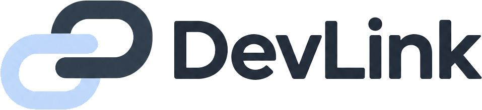

<div align="center">

<a href="https://about.devlink.ai.kr/">
  <picture>
    <source media="(prefers-color-scheme: dark)" srcset="src/assets/image/logo/devlink-logo-dark.png">
    <source media="(prefers-color-scheme: light)" srcset="src/assets/image/logo/devlink-logo.png">
    
  </picture>
</a>

# DevLink Frontend

**팀의 AI Agent와 작업 흐름을 한눈에 확인하세요.**

팀·Agent 연결부터 작업 대화와 변경 영향 확인까지, DevLink의 웹 화면과 데스크톱 앱을 제공합니다.

[](LICENSE.txt)


[English](README.md) · **한국어**

[빠른 시작](#빠른-시작) · [사용 예시](#사용-예시) · [동작 구조](#동작-구조) · [설정](#설정) · [개발하기](#개발하기) · [문서](#문서) · [라이선스](#라이선스)

</div>

## 소개

DevLink는 팀원들이 사용하는 AI 코딩 도구 사이에서 작업 요청과 개발 맥락을 전달하는 협업 도구입니다.

프론트엔드 개발자가 Codex를, 백엔드 개발자가 Claude Code를 사용하더라도 각자의 개발 환경에서 상대 Agent에게 작업을 요청하고 질문·답변·진행 상황·결과를 같은 작업 안에서 확인할 수 있습니다.

이 저장소는 **웹 워크스페이스와 Windows 데스크톱 앱**을 관리합니다. 웹에서는 팀과 Agent를 관리하고 팀 전체의 작업·대화를 조회합니다. 데스크톱 앱에서는 로컬 프로젝트를 연결하고 AI 도구의 MCP 설정과 작업 알림을 함께 관리합니다.

인증·작업 저장·전달 API는 [서버](https://github.com/SSAFY-URAYAHA/DevLink_server), 로컬 브로커·CLI·MCP 서버는 [클라이언트](https://github.com/SSAFY-URAYAHA/DevLink_client) 저장소에서 관리합니다. 코드 분석·수정·테스트는 사용자의 AI 도구가 수행합니다.

## 주요 기능

- **계정과 팀 관리** — 회원가입·로그인, 팀 생성·초대코드 참여, 팀원 조회를 제공합니다.
- **Agent 관리** — 팀 Agent의 등록·수정·삭제, 연결 토큰 발급과 접속 상태 확인을 지원합니다.
- **팀 작업과 대화 조회** — 팀 전체의 최근 작업, 작업 상세, 질문·답변·상태 변경·완료 결과를 확인합니다.
- **실시간 갱신** — SSE로 작업 변경과 Agent 접속 상태를 반영하고, 작업별 읽음 상태를 관리합니다.
- **변경 영향 확인** — 저장소의 의존성 그래프와 현재 작업 파일을 바탕으로 연결 관계와 변경 경로를 보여줍니다.
- **데스크톱 프로젝트 연결** — 로컬 프로젝트와 AI 도구를 선택하고, 지원 버전에 맞춰 MCP 설정을 적용하거나 직접 설정할 내용을 안내합니다.
- **데스크톱 작업 알림** — 로컬 브로커에서 새 작업·질문·답변과 작업 결과를 확인하고, 알림에서 해당 대화로 이동합니다.

## 사용 예시

### 팀의 Agent와 작업 진행 상황 확인

1. 웹에서 회원가입·로그인 후 팀을 생성하거나 초대코드로 참여합니다.
2. Agent 화면에서 팀에 등록된 Agent와 접속 상태를 확인합니다.
3. 각자의 AI 도구에서 DevLink MCP로 작업을 주고받습니다.
4. 웹의 최근 작업 목록에서 작업을 선택해 요약·상태와 대화 이력을 확인합니다.

예를 들어 프론트엔드 Agent가 백엔드 Agent에게 “게시글 목록 API의 응답 지연을 분석해 주세요”라고 요청하면, 팀원은 웹에서 해당 작업의 질문·답변과 완료 결과를 함께 확인할 수 있습니다. 목록에는 본인이 참여하지 않은 작업을 포함한 **팀 전체 작업**이 표시됩니다.

Agent를 등록하거나 토큰을 발급하는 것만으로 온라인 상태가 되지는 않습니다. 로컬 브로커와 AI 도구의 연결이 필요합니다.

### 데스크톱에서 로컬 프로젝트 연결

1. [릴리스](https://github.com/SSAFY-URAYAHA/DevLink_frontend/releases)에서 Windows 설치 파일을 내려받아 실행합니다.
2. 로그인 후 시작 안내 또는 **Agent → Agent 추가**에서 프로젝트 연결을 진행합니다.
3. 프로젝트 폴더와 사용할 AI 도구를 선택하고 연결 안내를 따릅니다.
4. 설정을 적용한 뒤 AI 도구를 다시 열어 실제 Agent 연결 상태를 확인합니다.

MCP 설정 준비 완료와 AI 도구 세션의 연결은 별도로 표시됩니다. 직접 설정과 연결 재개 방법은 [데스크톱 안내](desktop/README.md)를 참고하세요.

### 저장소의 변경 영향 확인

로그인 후 `/tree?mode=team`에 접속하면 팀 저장소의 실제 의존성 그래프와 작업 상태를 조회합니다. 팀 OWNER는 저장소 키·기준 브랜치·발행 Agent 등을 등록할 수 있으며, 브로커가 분석 데이터를 업로드해야 그래프가 표시됩니다.

`/tree`는 로그인 없이 확인하는 **샘플 그래프 화면**입니다. 실제 팀 데이터와 구분해 사용하세요.

## 빠른 시작

### 1. 준비하기

- **Git**
- **Node.js 24 권장**, npm — 잠금 파일의 Vite 기준 지원 범위는 Node.js `^20.19.0 || >=22.12.0`입니다.
- 실행 중인 **DevLink 서버** — 기본 연결 주소는 `http://localhost:8080`입니다.

```sh
node --version
npm --version
```

프론트엔드 자체 실행에는 Java·Rust·Docker가 필요하지 않습니다. 서버도 로컬에서 실행하려면 [서버 빠른 시작](https://github.com/SSAFY-URAYAHA/DevLink_server#quick-start)을 먼저 진행하세요. 로컬 Agent 연결에는 별도의 클라이언트 또는 데스크톱 설정이 필요합니다.

### 2. 저장소와 의존성 준비

```sh
git clone https://github.com/SSAFY-URAYAHA/DevLink_frontend.git
cd DevLink_frontend
npm ci
```

환경 변수 예시를 `.env.local`로 복사합니다. 기존 파일이 있다면 내용을 확인해 필요한 값만 변경하세요.

**Windows PowerShell**

```powershell
if (!(Test-Path .env.local)) { Copy-Item .env.example .env.local }
```

**macOS / Linux**

```sh
[ -f .env.local ] || cp .env.example .env.local
```

기본 로컬 설정은 다음과 같습니다.

```dotenv
VITE_API_BASE_URL=
DEVLINK_API_PROXY_TARGET=http://localhost:8080
```

### 3. 개발 서버 실행

```sh
npm run dev -- --host localhost --port 5173 --strictPort
```

브라우저에서 [http://localhost:5173](http://localhost:5173)에 접속합니다. 서버가 실행 중이면 로그인 화면이 표시되며, 회원가입 후 팀 생성·참여까지 진행할 수 있습니다.

로그인·팀 조회가 실패하면 프론트 터미널뿐 아니라 백엔드 실행 상태와 `.env.local`의 연결 주소도 확인하세요. 이 화면은 실제 서버 API를 사용합니다.

## 동작 구조

| 구성 요소 | 역할 |
| --- | --- |
| 웹 UI | 사용자 로그인, 팀·Agent 관리, 작업·대화 조회, 의존성 그래프 표시 |
| DevLink 서버 | 사용자 세션·권한 검증, 데이터 저장, REST API와 SSE 제공 |
| Electron 앱 | 웹 UI 표시, 로컬 프로젝트 연결, CLI 호출과 작업 알림 |
| 로컬 클라이언트 | CLI·브로커·MCP 서버를 통해 AI 도구와 중앙 서버 연결 |
| AI 도구 | 사용자의 프로젝트에서 작업 분석·코드 수정·테스트 수행 |

웹 UI는 쿠키 기반 사용자 세션으로 REST API를 호출하고 SSE로 변경 알림을 받습니다. 데이터 조회와 캐시는 TanStack Query, HTTP 요청은 공통 Axios 클라이언트를 사용합니다.

브라우저에서 실행한 웹 UI는 로컬 CLI를 직접 실행하지 않습니다. 데스크톱 앱은 Electron IPC를 통해 로컬 연결 기능을 제공합니다. 패키징된 앱은 `https://devlink.ai.kr`, 개발 중인 앱은 `http://localhost:5173`의 웹 UI를 불러옵니다.

## 설정

| 환경 변수 | 용도 | 로컬 기본값 |
| --- | --- | --- |
| `VITE_API_BASE_URL` | 브라우저가 호출할 백엔드 Origin | 빈 값 |
| `DEVLINK_API_PROXY_TARGET` | Vite 개발 프록시가 연결할 백엔드 주소 | `http://localhost:8080` |

### 로컬 API 연결

`VITE_API_BASE_URL`을 비워두면 브라우저의 `/api` 요청을 Vite가 백엔드로 전달합니다. 로컬 개발에서는 이 프록시를 사용하므로 프론트 주소를 백엔드 CORS에 추가하지 않고 세션 쿠키를 사용할 수 있습니다.

백엔드 포트가 다르면 `DEVLINK_API_PROXY_TARGET`을 변경하고 개발 서버를 다시 실행합니다. 개발 프록시는 전달 시 Origin 헤더를 제거하며, 백엔드의 세션·CSRF 검증은 유지됩니다.

### 운영 배포

배포 환경에서는 `VITE_API_BASE_URL`에 실제 HTTPS 백엔드 Origin을 지정합니다.

```dotenv
VITE_API_BASE_URL=https://api.example.com
```

위 주소는 예시입니다. 실제 주소로 교체하고 **`/api` 또는 `/api/v1`은 붙이지 않습니다.** 공통 API 클라이언트가 경로를 추가합니다.

- `VITE_` 변수는 빌드 결과에 포함되어 공개됩니다. 비밀번호·Agent 토큰을 넣지 마세요.
- 값을 변경하면 다시 빌드·배포해야 합니다.
- `DEVLINK_API_PROXY_TARGET`은 개발 서버 전용입니다. `npm run preview`와 정적 배포에는 적용되지 않습니다.
- 백엔드에는 프론트 Origin에 대한 CORS 허용, 쿠키 포함 요청 허용과 운영 세션 쿠키 설정이 필요합니다. 사이트가 다르면 브라우저의 서드파티 쿠키 정책도 확인하세요.

Vercel 설정은 다음과 같습니다.

| 항목 | 값 |
| --- | --- |
| 프레임워크 | Vite |
| 빌드 명령 | `npm run build` |
| 출력 폴더 | `dist` |
| 환경 변수 | `VITE_API_BASE_URL` |

루트의 [vercel.json](vercel.json)은 `/tree` 같은 경로의 직접 접속·새로고침을 처리하는 SPA 재작성 설정입니다. 백엔드 API 프록시를 제공하지 않습니다.

### 인증과 연결 토큰

웹 API 요청은 `withCredentials`로 세션 쿠키를 포함하고, 상태 변경 요청 전에 CSRF 토큰을 조회합니다. 새로고침 시 내 정보 API로 로그인 상태를 복원합니다.

비밀번호·세션 식별자·Agent 토큰은 브라우저 저장소에 보관하지 않습니다. 발급한 Agent 토큰은 현재 화면에서 확인·복사하며, 재발급 시 기존 연결이 영향을 받을 수 있으므로 안내를 확인하세요. 화면 설정과 작업 읽음 상태 등은 브라우저에 저장될 수 있습니다.

웹 로그아웃과 Agent 연결 종료는 별개입니다. 두 계정으로 확인할 때는 다른 브라우저나 시크릿 창을 사용해 세션을 분리하세요.

## 개발하기

### 주요 명령

저장소 루트의 명령입니다.

| 명령 | 설명 |
| --- | --- |
| `npm run dev` | Vite 개발 서버 실행 |
| `npm run build` | TypeScript 검사 후 프로덕션 번들 생성 |
| `npm run preview` | 생성된 번들 미리보기 |
| `npm run lint` | ESLint 검사 |

루트에는 별도의 `npm test` 스크립트가 없습니다. 데스크톱 실행·패키징과 검증 명령은 [데스크톱 개발 문서](desktop/README.md)에서 안내합니다.

### 코드 구조

```text
src/
├── app/                    # 진입점, 라우팅, 공통 Provider
├── pages/                  # 인증·워크스페이스·의존성 화면
├── features/
│   ├── auth/               # 계정과 세션
│   ├── teams/              # 팀·팀원·초대코드
│   ├── agents/             # Agent 관리와 토큰 발급
│   ├── tasks/              # 작업 목록·대화·실시간 갱신
│   ├── dependency-tree/    # 저장소 의존성과 변경 영향
│   ├── desktop-setup/      # 프로젝트·MCP 연결과 알림
│   ├── workspace/          # 워크스페이스 화면 구성
│   └── team-preview/       # 3D 팀 화면과 디자인 미리보기
├── components/             # 공통 UI
└── lib/                    # 공통 API 클라이언트와 Query Client

desktop/                    # Electron 앱과 Windows 설치 파일 구성
```

공통 Axios 인스턴스·Query Client를 재사용하고, 기능별 API와 훅은 해당 기능 폴더에서 관리합니다. `/team-network`, `/team-observatory`, `/team-orbit`, `/team-preview`, `/dashboard-design`은 디자인 미리보기 경로입니다.

## 문서

- [DevLink 소개](https://about.devlink.ai.kr/)
- [데스크톱 개발·프로젝트 연결·MCP 설정](desktop/README.md)
- [3D 팀 스페이스 디자인 검토 기록](docs/team-space-design-notes.md)
- [서버 실행과 API 안내](https://github.com/SSAFY-URAYAHA/DevLink_server#readme)
- [클라이언트·CLI·MCP 안내](https://github.com/SSAFY-URAYAHA/DevLink_client#readme)
- [Windows 설치 파일과 릴리스](https://github.com/SSAFY-URAYAHA/DevLink_frontend/releases)
- [기여 가이드](CONTRIBUTING.ko.md)
- [커뮤니티 행동 규칙](docs/ko/CODE_OF_CONDUCT.md)
- [보안 정책](SECURITY.ko.md)

## 라이선스

이 프로젝트는 [MIT 라이선스](LICENSE.txt)를 따릅니다. 전체 조건과 저작권 표기는 라이선스 파일을 확인하세요.
