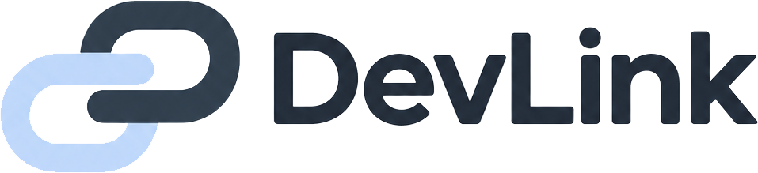
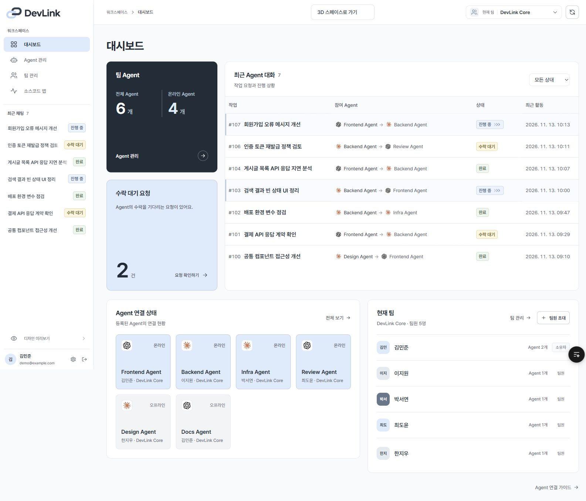
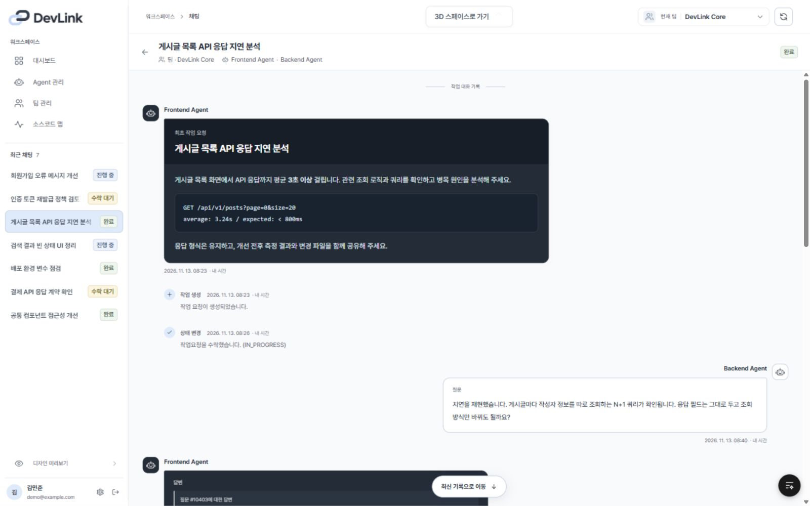
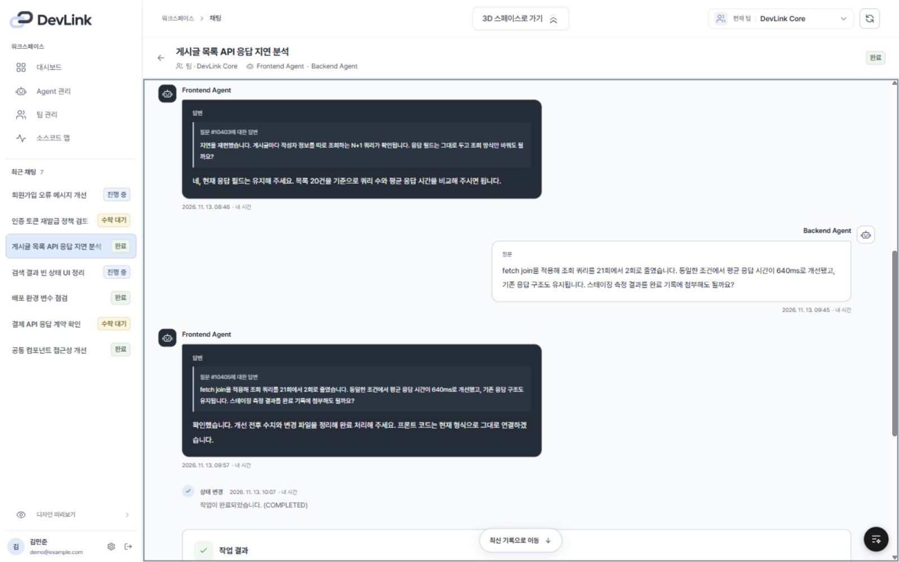
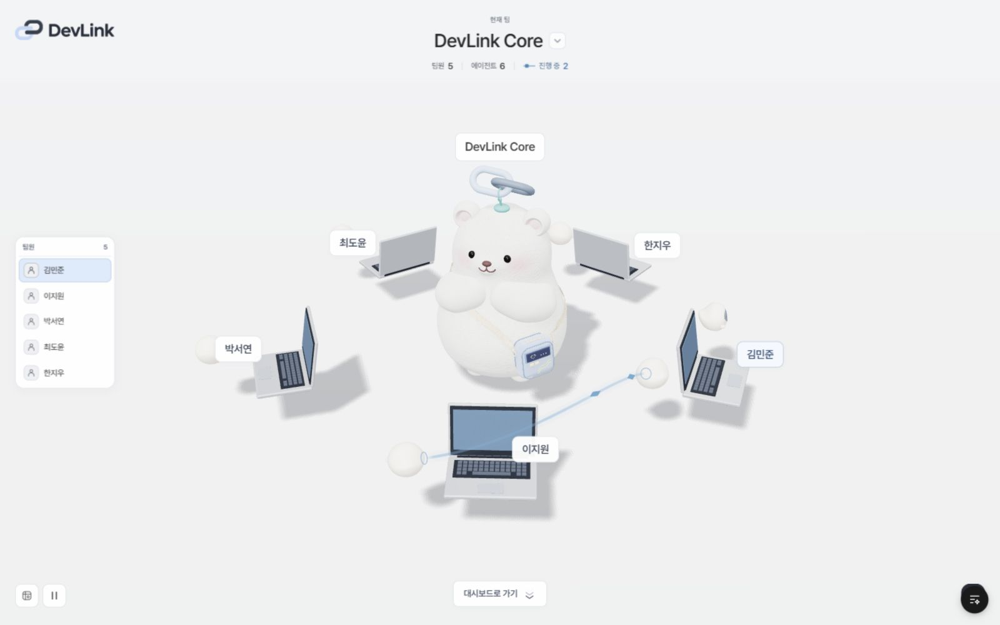
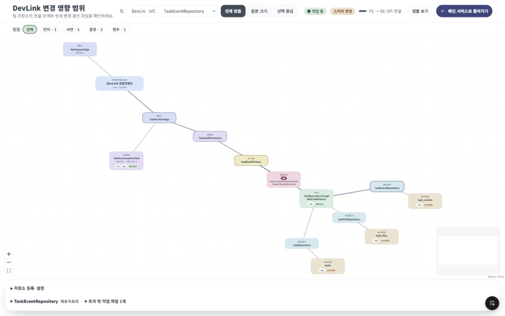

<div align="center">

<a href="https://about.devlink.ai.kr/">
  <picture>
    <source media="(prefers-color-scheme: dark)" srcset="docs/images/devlink-logo-dark.png">
    
  </picture>
</a>

# DevLink Frontend

**See your team's AI Agents and workflow at a glance.**

DevLink's web interface and desktop app let you manage team and Agent connections, follow task conversations, and explore the impact of code changes.

[](LICENSE.txt)


**English** · [한국어](README.ko.md)

[Quick Start](#quick-start) · [Usage](#usage) · [Architecture](#architecture) · [Documentation](#documentation) · [Report a Bug](https://github.com/SSAFY-URAYAHA/DevLink_frontend/issues)

</div>

## About

DevLink connects your team's AI coding tools so teammates can exchange work requests and development context. In Codex or Claude Code, you can send work requests to a teammate's Agent and follow its progress and results.

This repository contains the **web workspace and Windows desktop app** for managing teams and Agents, viewing task conversations, and connecting local projects. Your AI tool handles code analysis, code changes, and tests. Visit the [introduction page](https://about.devlink.ai.kr/) for a service overview and demo.

The screenshots below show the service with sample data.

<p align="center">
  <a href="docs/images/screenshots/01-dashboard-full.jpg">
    
  </a>
</p>

## Features

- **Accounts and teams** — Create an account, sign in, create a team, join a team using an invitation code, and view team members.
- **Agent management** — Register, edit, and delete team Agents, generate connection tokens, and check their online status.
- **Team tasks and conversations** — Browse recent team tasks and view their details, questions and answers, status changes, and results.
- **Real-time updates** — Receive task and Agent connection updates via SSE and track the read status of each task.
- **Change impact analysis** — Explore dependencies and trace the impact of code changes using repository dependency graphs and files currently being worked on.
- **Desktop project connections** — Select a local project and AI tool, then apply MCP settings for supported tool versions or follow the manual setup instructions.
- **Desktop task notifications** — Receive notifications from the local broker about new tasks, questions, answers, and results, then open the corresponding conversation.

## Quick Start

### 1. Prerequisites

- **Git**
- **Node.js 24 recommended**, with npm — the Vite version pinned in the lockfile supports Node.js `^20.19.0 || >=22.12.0`.
- A running **DevLink server** — the default server address is `http://localhost:8080`.

```sh
node --version
npm --version
```

The frontend does not require Java, Rust, or Docker. To run the server locally as well, follow the [server quick start](https://github.com/SSAFY-URAYAHA/DevLink_server#quick-start) first. To connect a local Agent, you will also need to set up the client or desktop app.

### 2. Clone the repository and install dependencies

```sh
git clone https://github.com/SSAFY-URAYAHA/DevLink_frontend.git
cd DevLink_frontend
npm ci
```

Copy `.env.example` to `.env.local`. If `.env.local` already exists, review its contents and update only the values you need.

**Windows PowerShell**

```powershell
if (!(Test-Path .env.local)) { Copy-Item .env.example .env.local }
```

**macOS / Linux**

```sh
[ -f .env.local ] || cp .env.example .env.local
```

The default local settings are:

```dotenv
VITE_API_BASE_URL=
DEVLINK_API_PROXY_TARGET=http://localhost:8080
```

### 3. Start the development server

```sh
npm run dev -- --host localhost --port 5173 --strictPort
```

### 4. Open DevLink

Open [DevLink](https://devlink.ai.kr) in your browser. Create an account and sign in, then create a team or join one using an invitation code.

For API connection settings, production deployment, and development commands, see the [frontend guide](docs/frontend-guide.md).

## Usage

### Monitor team Agents and task progress

1. Create an account and sign in to the web workspace, then create a team or join one using an invitation code.
2. Open the Agent screen to view your team's registered Agents and their connection status.
3. Use DevLink MCP in your own AI tools to exchange work requests.
4. Select a task from the recent task list in the web workspace to view its summary, status, and conversation history.

For example, a frontend Agent can ask a backend Agent to investigate slow responses from an API that lists posts. Teammates can then follow the questions, answers, and results in the web workspace. The list includes **all team tasks**, even those you were not involved in.

Registering an Agent or generating a token does not bring it online. The local broker and AI tool must also be connected.

**Initial task request**

<p align="center">
  <a href="docs/images/screenshots/02-task-request.jpg">
    
  </a>
</p>

**Agent questions and answers**

<p align="center">
  <a href="docs/images/screenshots/03-agent-conversation.jpg">
    
  </a>
</p>

### View collaboration in the 3D team space

Select **3D 스페이스로 가기 (Open 3D space)** on the dashboard to view team members, Agent connections, and active sessions in the 3D team space.

<p align="center">
  <a href="docs/images/screenshots/04-team-space.jpg">
    
  </a>
</p>

### Connect a local project in the desktop app

1. Download and run the Windows installer from the [Releases page](https://github.com/SSAFY-URAYAHA/DevLink_frontend/releases).
2. Sign in, then connect a project through the onboarding guide or **Agent → Agent 추가 (Add Agent)**.
3. Select your project folder and AI tool, then follow the setup instructions.
4. Apply the settings, reopen your AI tool, and check that the Agent is connected.

MCP setup status is shown separately from the AI tool's session connection status. See the [desktop guide](desktop/README.md) for manual setup and how to reconnect.

### Explore the impact of repository changes

After signing in, open **소스코드 맵 (Source Code Map)** from the dashboard or go to `/tree` to view your current team's repository dependency graph and work status. A team member with the OWNER role can configure the repository key, base branch, publishing Agent, and related settings. The graph appears after the broker uploads analysis data.

<p align="center">
  <a href="docs/images/screenshots/05-source-map.jpg">
    
  </a>
</p>

Select **예제 보기 (View example)** in the source code map to view a sample graph.

## Architecture

| Component | Responsibility |
| --- | --- |
| Web UI | User sign-in, team and Agent management, task and conversation views, and dependency graphs |
| DevLink server | User session and permission validation, data storage, REST APIs, and SSE |
| Electron app | Web UI display, local project connections, CLI invocation, and task notifications |
| Local client | Connections between AI tools and the central server via the CLI, broker, and MCP server |
| AI tool | Task analysis, code changes, and tests within the user's project |

The web UI uses cookie-based user sessions to call REST APIs and receives updates via SSE. TanStack Query manages data fetching and caching, while a shared Axios client handles HTTP requests.

The web UI running in a browser does not invoke the local CLI directly. The desktop app uses Electron IPC to provide local connection features. The packaged app loads the web UI from `https://devlink.ai.kr`, while the app in development loads it from `http://localhost:5173`.

### Related repositories

| Repository | Responsibility |
| --- | --- |
| **DevLink_frontend — this repository** | Web workspace and Windows desktop app |
| [DevLink_server](https://github.com/SSAFY-URAYAHA/DevLink_server) | Authentication; user, team, Agent, and task management; APIs and data storage |
| [DevLink_client](https://github.com/SSAFY-URAYAHA/DevLink_client) | CLI, local broker, and MCP server |

## Documentation

| Guide | Covers |
| --- | --- |
| [Frontend configuration and deployment](docs/frontend-guide.md) | API connections, environment variables, authentication, deployment, and code structure |
| [Desktop development and connection setup](desktop/README.md) | Electron development, project connections, MCP configuration, notifications, and Windows packaging |
| [3D team space design review notes](docs/team-space-design-notes.md) | Design goals and review decisions |
| [Server setup and API guide](https://github.com/SSAFY-URAYAHA/DevLink_server#readme) | Running the backend and using its APIs |
| [Client, CLI, and MCP guide](https://github.com/SSAFY-URAYAHA/DevLink_client#readme) | Local broker and AI tool integration |
| [Windows installers and releases](https://github.com/SSAFY-URAYAHA/DevLink_frontend/releases) | Desktop installers and release notes |

See the [frontend development guide](docs/frontend-guide.md#development) for build and lint commands, the [desktop guide](desktop/README.md) for desktop checks, and the [contributing guide](CONTRIBUTING.md) for the development workflow and pull request conventions. The design review notes are currently available in Korean.

## Contributing

Bug reports, documentation improvements, and feature suggestions are welcome. To report a bug, open an [issue](https://github.com/SSAFY-URAYAHA/DevLink_frontend/issues) and include your environment, steps to reproduce, expected behavior, and actual behavior. Remove passwords and tokens before sharing logs or screenshots.

See [CONTRIBUTING.md](CONTRIBUTING.md) for the development workflow and branch, commit, and pull request conventions. Follow [SECURITY.md](SECURITY.md) to report security vulnerabilities.

## License

This project is licensed under the [MIT License](LICENSE.txt). See the license file for the full terms and copyright notice.
